# Sprint 4 · Portal multirrol de Constructora El Salvador

Plataforma de renta y venta de maquinaria pesada con cuatro tipos de cuenta:
**cliente**, **proveedor**, **empleado** y **administración**. El módulo de
contratos de obra de los sprints anteriores (catálogo, contrato, firma, PDF,
alertas, cobros y recepción) se conserva completo y ahora usa la misma identidad visual.

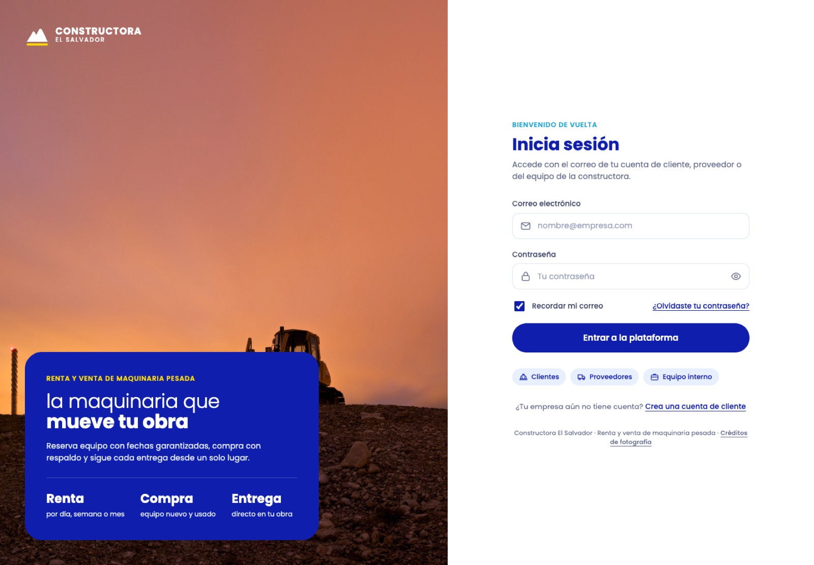

## Cómo ejecutarlo

```sh
npm ci
npm test        # 188 pruebas, incluidas las 13 del portal
npm start       # http://localhost:3000
```

En desarrollo (sin `DATABASE_URL`) el servidor usa PGlite y, al primer
arranque, carga los **datos de demostración**: cuentas de prueba, 11 equipos con
fotografías reales y 10 pedidos en distintos estados. Para arrancar sin ellos usa
`DEMO_DATA=false npm start`. Los datos se guardan en `data/`.

## Cuentas de prueba

| Rol | Correo | Entra a |
| --- | --- | --- |
| Cliente | `2024-5301@esen.edu.sv` | Portal · tienda, carrito y pedidos |
| Proveedor | `2024-5200@esen.edu.sv` | Portal · mis productos y liquidaciones |
| Administración | `2025-5714@esen.edu.sv` | Portal · panel ejecutivo, tasas, usuarios, auditoría |
| Empleado | `2025-5012@esen.edu.sv` | Portal · operación, moderación, usuarios + contratos de obra |
| Empleado | `2025-5665@esen.edu.sv` | Igual que el empleado anterior |

Las contraseñas **no están en el repositorio**: el código guarda solo su hash
(`backend/demo-data.mjs`) y se entregan por un canal privado. Cualquier
administrador o empleado puede generar una contraseña temporal desde
**Usuarios → icono de llave**.

## Roles y permisos

La matriz vive en `backend/permisos.mjs`. Residente y gerente conservan
exactamente sus permisos anteriores.

| Permiso | Cliente | Proveedor | Empleado | Admin |
| --- | :-: | :-: | :-: | :-: |
| Ver catálogo de la tienda | ✓ | ✓ | ✓ | ✓ |
| Crear pedidos (comprar / reservar) | ✓ | | | |
| Ver pedidos | propios | con sus equipos | todos | todos |
| Publicar y editar productos | | propios | | todos |
| Moderar publicaciones | | | ✓ | ✓ |
| Aprobar, despachar y cerrar pedidos | | | ✓ | ✓ |
| Crear usuarios | | | clientes y proveedores | todos los roles |
| Cambiar roles y desactivar cuentas | | | | ✓ |
| Editar tasas (IVA, comisión, flete…) | | | | ✓ |
| Bitácora de auditoría y reportes | | | | ✓ |
| Contratos de obra (módulo anterior) | | | ✓ | ✓ |

## Pantallas nuevas

| # | Pantalla | Ruta | Rol |
| --- | --- | --- | --- |
| 1 | Inicio de sesión con foto, mostrar contraseña y aviso de Bloq Mayús | `/login.html` | Público |
| 2 | Registro de cliente con medidor de seguridad | `/registro.html` | Público |
| 3 | Recuperar contraseña | `/recuperar.html` | Público |
| 4 | Nueva contraseña | `/restablecer.html` | Público |
| 5 | Inicio del cliente (pedidos con progreso, destacados) | `#/inicio` | Cliente |
| 6 | Catálogo con filtros por tipo, modalidad, condición y orden | `#/catalogo` | Todos |
| 7 | Ficha de producto: galería, calendario de disponibilidad, cotización en vivo | `#/producto/:id` | Todos |
| 8 | Carrito y pago (fechas editables, operador, forma de pago) | `#/carrito` | Cliente |
| 9 | Lista de pedidos con filtros por estado | `#/pedidos` | Todos |
| 10 | Detalle del pedido con historial, totales o liquidación | `#/pedido/:id` | Todos |
| 11 | Resumen del proveedor (ventas, neto, ranking) | `#/inicio` | Proveedor |
| 12 | Productos (estilo tienda en línea) | `#/productos` | Proveedor, empleado, admin |
| 13 | Editor de producto: fotos, precios, inventario, ficha técnica, vista previa | `#/productos/nuevo` | Proveedor, admin |
| 14 | Panel de operación (cola de aprobación, moderación) | `#/inicio` | Empleado |
| 15 | Moderación de catálogo | `#/moderacion` | Empleado, admin |
| 16 | Usuarios y contraseñas temporales | `#/usuarios` | Empleado, admin |
| 17 | Panel ejecutivo con ingresos por mes | `#/inicio` | Admin |
| 18 | Tasas con simulación de un pedido típico | `#/tasas` | Admin |
| 19 | Bitácora de auditoría | `#/auditoria` | Admin |
| 20 | Mi perfil y cambio de contraseña | `#/perfil` | Todos |
| 21 | Créditos de fotografía | `/creditos.html` | Público |

| | |
| --- | --- |
| 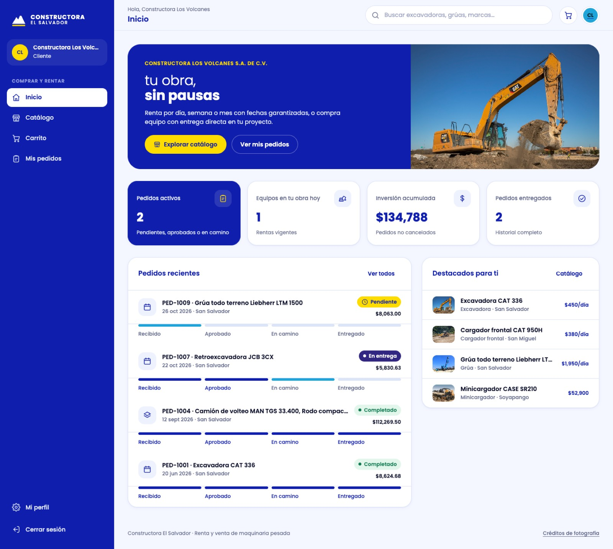 | 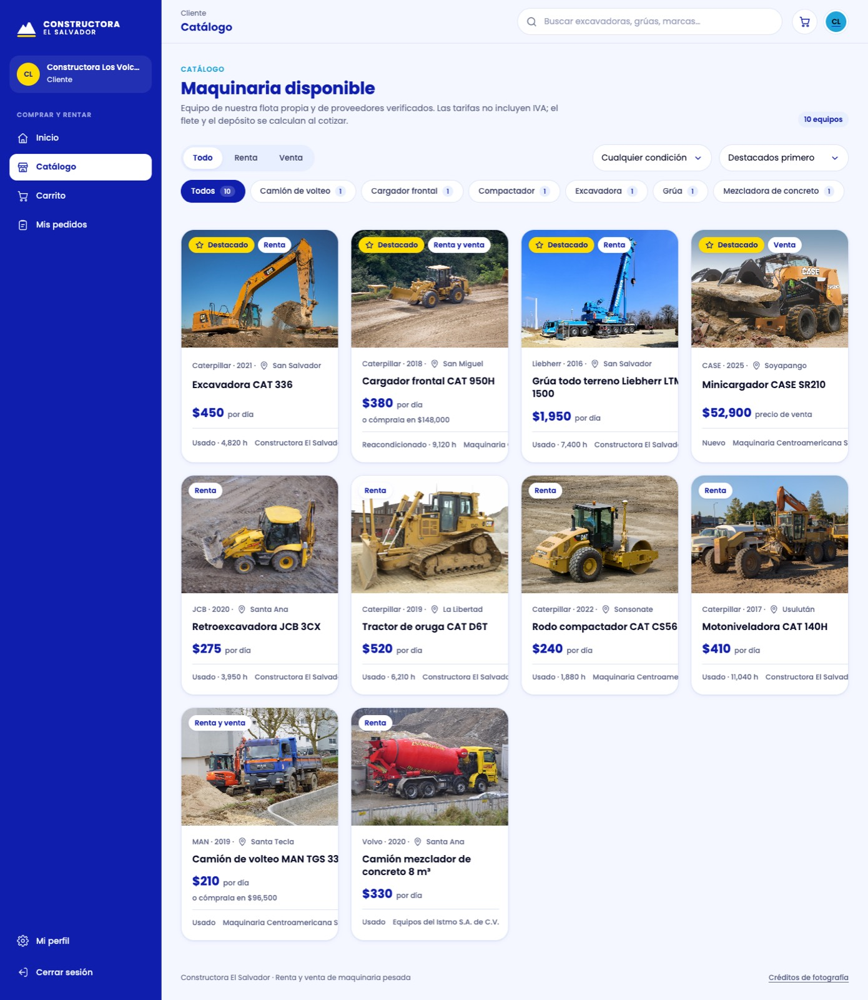 |
| 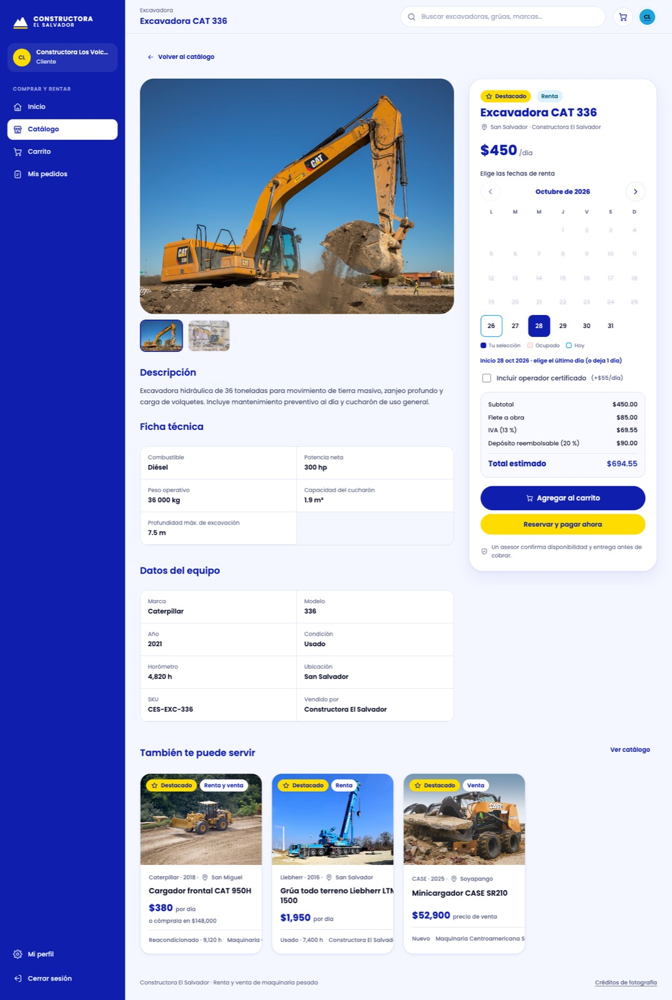 | 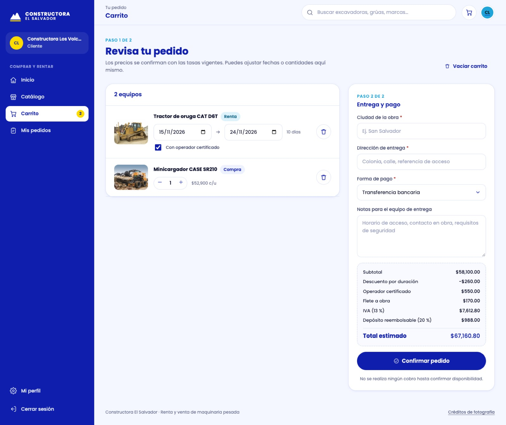 |
| 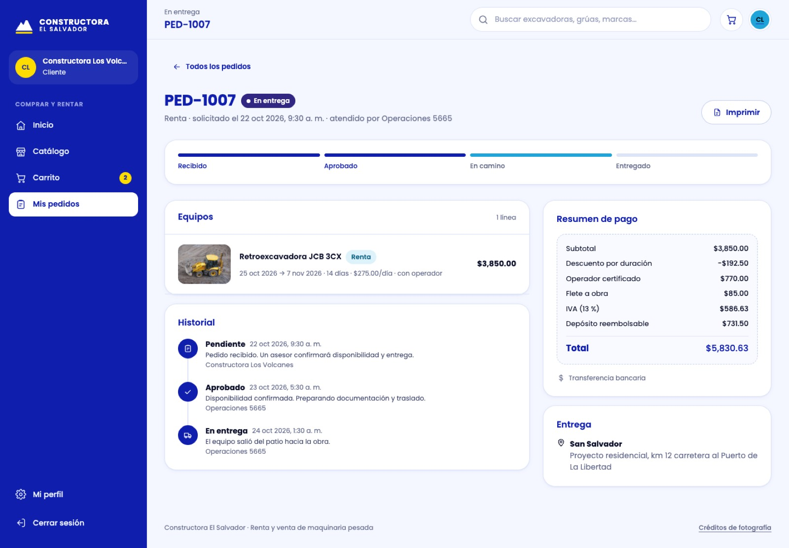 | 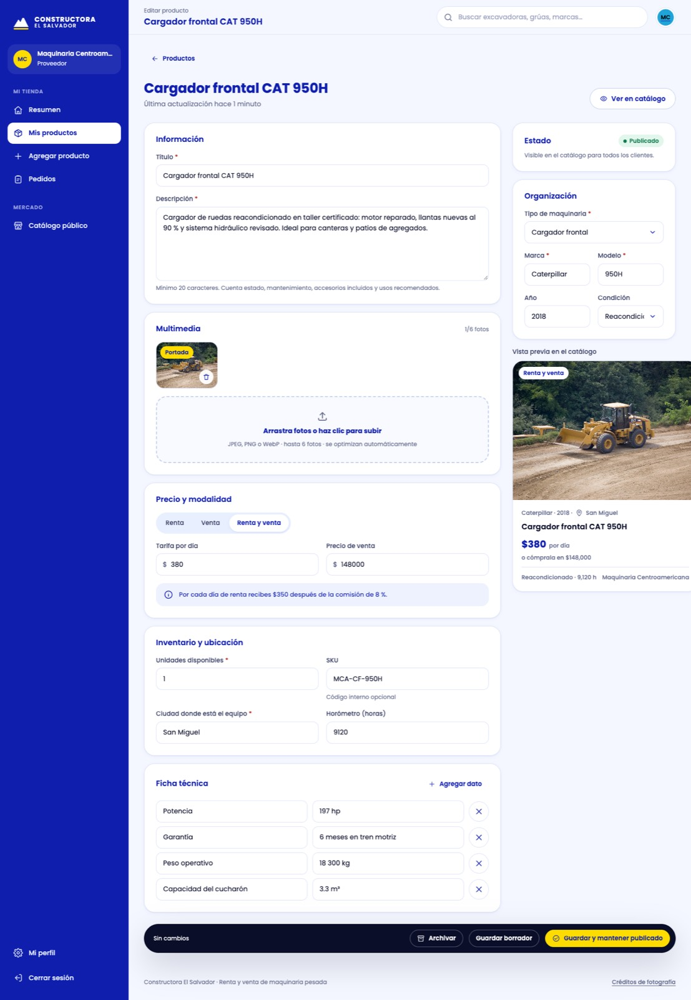 |
| 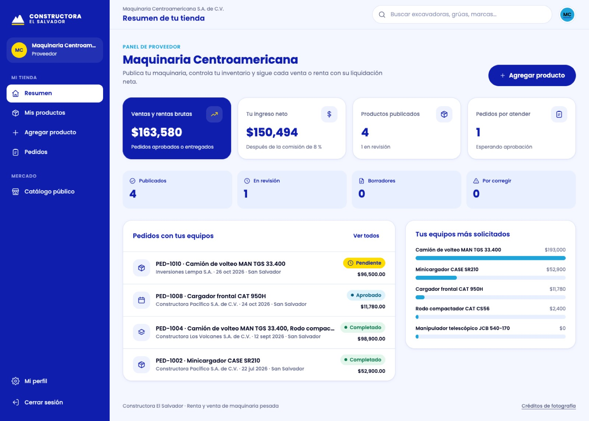 | 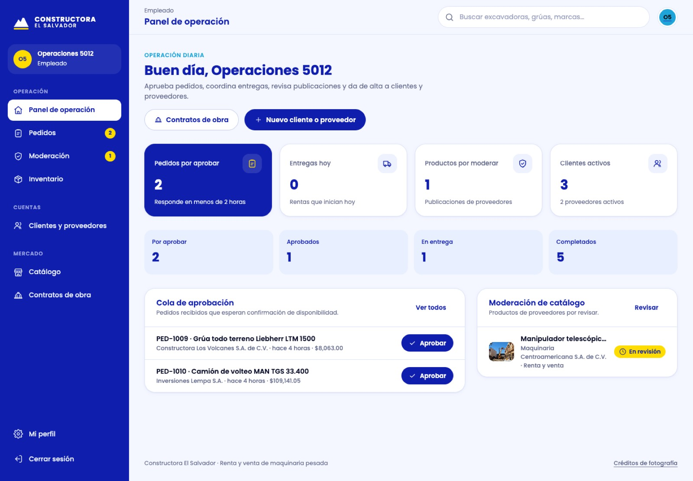 |
| 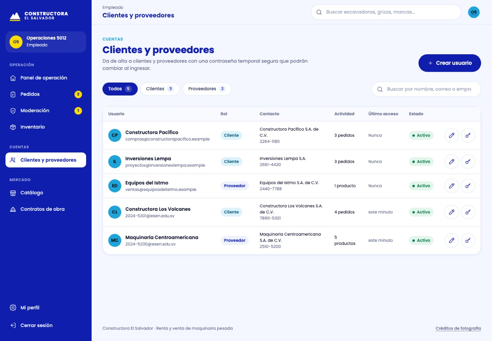 | 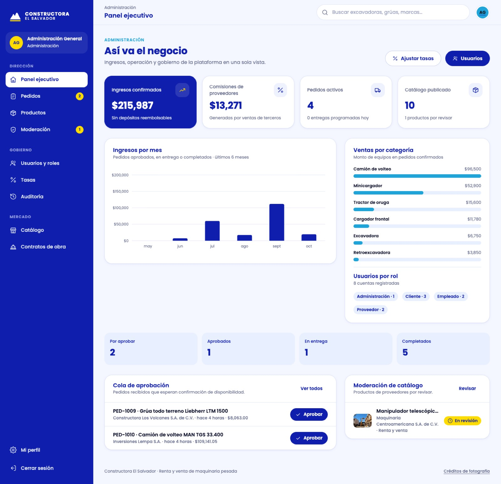 |

## Escenarios de prueba

Automatizados en `backend/portal.test.mjs` contra el servidor HTTP real:

| # | Escenario | Resultado esperado |
| --- | --- | --- |
| E1 | Cada rol inicia sesión | Recibe solo sus permisos; `app.html` sin sesión redirige al login; un cliente no ve usuarios (403) |
| E2 | Registro público | Contraseña débil rechazada; siempre crea rol cliente; correo repetido → 409 |
| E3 | Proveedor publica un equipo | Queda **En revisión** y no aparece en la tienda; las fotos se sirven optimizadas |
| E4 | Empleado modera | Rechazar exige motivo; aprobar lo publica en el catálogo |
| E5 | Proveedor ajeno intenta editar | 403 y su lista de productos no muestra equipos de otros |
| E6 | Cotización de renta de 10 días con operador | 5 % de descuento semanal, operador, flete, IVA 13 % y depósito 20 % exactos |
| E7 | Reserva de renta | Bloquea las fechas en el portal **y** en los contratos de obra; reserva doble → 409 |
| E8 | Compra | Aparta inventario; sin existencias → 409; cancelar devuelve el inventario |
| E9 | Flujo del pedido | No se puede saltar estados; el cliente ve Pendiente → Aprobado → En entrega → Completado |
| E10 | Empleado crea un proveedor | Recibe clave temporal; no puede crear administradores; restablecer cierra sesiones |
| E11 | Administración cambia tasas | Fuera de rango → 400; las cotizaciones nuevas usan la tasa; queda en auditoría |
| E12 | Cambio de rol | El administrador promueve, no puede desactivarse a sí mismo; el cambio cierra sesiones |
| E13 | Cambio de contraseña | Exige la actual; conserva la sesión en uso y cierra las demás |

Recorrido manual sugerido (5 minutos):

1. Entra como **cliente**, abre una excavadora, elige fechas en el calendario y marca operador: la cotización se recalcula sola. Agrégala al carrito y confirma el pedido.
2. Entra como **empleado**: el pedido aparece en la cola de aprobación. Apruébalo, márcalo en entrega y confírmalo desde el detalle.
3. Vuelve como cliente: el pedido muestra el avance y el historial con quién lo atendió.
4. Entra como **proveedor**, crea un producto con fotos y envíalo a revisión. Como empleado, apruébalo en **Moderación**: ya aparece en el catálogo.
5. Entra como **administración**, sube el IVA en **Tasas** y revisa la simulación; el cambio queda en **Auditoría**.
6. En **Usuarios**, crea un cliente nuevo y entra con la contraseña temporal generada.

## Base de datos

Cambios aditivos en `database/schema.sql`: columnas comerciales en `maquinaria`
(proveedor, marca, modelo, año, condición, modalidad, precio de venta, inventario,
SKU, estado de publicación, imágenes, ficha técnica), datos de contacto en
`usuario` y las tablas `configuracion`, `pedido`, `pedido_item`, `pedido_evento` y
`auditoria`. El validador de producción (`backend/postgres-preparation.mjs`)
conoce las tablas nuevas y sus relaciones.

Para una base PostgreSQL ya existente (Supabase/Render), en este orden:

1. Ejecutar la migración revisada `database/migrations/20261026_portal_multirrol.sql` (amplía los roles permitidos).
2. `npm run db:init -- --existing-reviewed` (crea columnas y tablas nuevas sin tocar datos).
3. Opcional: `npm run db:demo` para cargar las cuentas y el catálogo de demostración.

Hasta completar esos pasos, el arranque en producción se detiene con el aviso de
esquema incompleto, igual que en las migraciones anteriores.

## Marca

Identidad de **Constructora El Salvador**: azul `#0F1EAD` como color principal,
celeste `#1EA4D9`, índigo `#312783` y gris blanco `#E8EFFF` en superficies, y
amarillo `#FEDC00` solo como acento. Tipografía única Poppins, sin itálicas ni
degradados, esquinas redondeadas en botones, tarjetas y campos. El logotipo
(`frontend/assets/brand/logo-constructora.svg`) es un volcán con cráter sobre una
franja amarilla de obra, acompañado del nombre de la marca. Iconografía de línea
uniforme, sin emojis. Fotografías de Wikimedia Commons con licencias CC BY /
CC BY-SA, acreditadas en `/creditos.html`.
